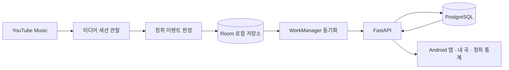
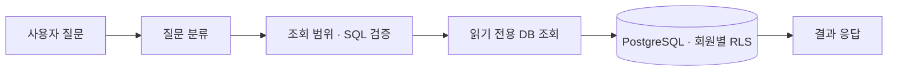

# FirstListen

> YouTube Music 청취 기록을 자동으로 모으고, 나만의 음악 기록을 찾아보는 Android 앱입니다.

FirstListen은 Android 기기에서 YouTube Music의 재생 정보를 관찰해 청취 이벤트를 기록합니다. 기록은 기기에 먼저 저장된 뒤 서버와 동기화되며, 앱에서 내 곡과 청취 통계를 확인하거나 자연어로 질문할 수 있습니다. YouTube Music Takeout 기록 가져오기도 지원합니다.

## 주요 기능

- **청취 기록 자동 수집** — 재생 중인 곡과 관찰한 청취 시간을 기록합니다. 30초 이상 기록된 이벤트가 서버 집계 대상입니다.
- **오프라인 저장 및 동기화** — Room에 먼저 기록하고 네트워크가 연결되면 WorkManager가 서버로 전송합니다.
- **내 곡과 통계** — 곡을 검색하고 최초 기록 시각, 누적 청취 시간, 이벤트 수를 확인합니다.
- **자연어 질문** — 예를 들어 “입춘을 처음 들은 게 언제야?”처럼 내 기록을 질문할 수 있습니다.
- **Takeout 가져오기** — YouTube Music 기록 파일을 가져와 기존 기록에 추가할 수 있습니다.

## 실행 방법

### 1. 백엔드 실행

필요한 도구는 Docker와 Docker Compose입니다. 저장소 루트에서 실행하세요.

```bash
docker compose up --build -d
```

Compose가 PostgreSQL을 준비하고 데이터베이스 마이그레이션을 적용한 뒤 FastAPI 서버를 실행합니다.

| 확인 항목 | 주소 또는 명령 |
| --- | --- |
| API 문서 (Swagger UI) | <http://localhost:8000/docs> |
| 생존 상태 | <http://localhost:8000/health> |
| DB 연결 상태 | <http://localhost:8000/ready> |
| 로그 확인 | `docker compose logs -f api` |
| 백엔드 종료 | `docker compose down` |

`docker compose down`은 데이터베이스 볼륨을 보존합니다. DB까지 초기화해야 하는 경우에만 `docker compose down -v`를 사용하세요. 기존 볼륨의 데이터베이스 비밀번호는 `.env` 변경만으로 바뀌지 않습니다.

기본 DB 비밀번호는 로컬 개발용입니다. 변경하려면 `.env.example`을 `.env`로 복사해 값을 수정하세요. 자연어 질문에 LLM 분류를 사용하려면 `.env`에 `PICKLE_API_KEY`를 설정한 뒤 다시 빌드·실행합니다. API 키가 비어 있으면 정규식 기반 분류를 사용합니다. `.env`에는 비밀 값을 넣고 Git에 올리지 마세요.

### 2. Android 앱 실행

1. Android Studio에서 저장소의 `android/` 폴더를 엽니다.
2. Gradle JDK를 **JDK 21**로, Android SDK Platform을 **36.1**로 설정하고 Build Tools **36.0.0**을 설치합니다.
3. 에뮬레이터 또는 Android 기기에서 앱을 실행합니다.
4. 앱에서 백엔드 주소를 설정하고 로그인합니다. 계정이 없다면 회원가입할 수 있습니다.
5. **알림 접근** 설정에서 FirstListen을 허용한 다음 앱으로 돌아와 **청취 기록 수집**을 켭니다.
6. YouTube Music에서 곡을 재생하고 앱의 **기록**, **내 곡**, **질문** 화면을 확인합니다.

Android에서 사용할 서버 주소:

| 실행 환경 | 서버 주소 |
| --- | --- |
| Android Emulator | `http://10.0.2.2:8000` |
| USB 연결 기기 | `adb reverse tcp:8000 tcp:8000` 설정 후 `http://127.0.0.1:8000` |
| 같은 Wi-Fi의 실제 기기 | `API_BIND=0.0.0.0 docker compose up --build -d` 실행 후 `http://<개발 PC의 LAN IP>:8000` |

실제 기기에서 LAN 주소를 사용하는 경우 API가 네트워크에 노출되므로 개발 목적으로만 사용하고, 필요한 경우 개발 PC 방화벽에서 8000 포트를 허용하세요. Android 앱 설치와 수집 규칙, 빌드·테스트 절차는 [Android 안내](android/README.md)를 참고하세요.

## 실행되는 구조

### 청취 기록 수집 및 동기화



1. Android의 `MusicNotificationListenerService`가 YouTube Music의 미디어 세션을 관찰합니다.
2. 청취 이벤트는 Room에 먼저 저장됩니다. 네트워크가 끊겨도 기기 기록을 보관하고 나중에 전송합니다.
3. WorkManager가 이벤트를 FastAPI로 보내고, 서버는 회원별 청취 기록을 PostgreSQL에 저장합니다.
4. 앱에서 곡 목록과 통계를 조회합니다. 기록된 청취 시간은 실제 청취 전체가 아니라 앱이 관찰한 시간이며, 설치 전 기록이나 수집 중단 중의 청취는 복구되지 않습니다.

### 자연어 질문



질문은 백엔드에서 분류하고 허용된 조회만 실행합니다. LLM은 설정에 따라 질문 분류나 SQL 제안에 사용될 수 있지만, SQL 검증과 읽기 전용 데이터베이스 권한, 회원별 접근 제어를 거쳐 조회합니다. LLM 설정 없이도 정규식 기반 질문 분류를 사용할 수 있습니다.

## 프로젝트 구조

```text
.
├── android/
│   ├── app/src/main/java/kr/firstlisten/app/
│   │   ├── capture/       # 미디어 세션 관찰 및 청취 이벤트 수집
│   │   ├── data/          # Room 로컬 DB와 세션 저장
│   │   ├── network/       # 백엔드 API 통신
│   │   ├── sync/          # WorkManager 동기화
│   │   └── ui/            # 기록, 내 곡, 질문 화면
│   └── core/              # 청취 판정 및 동기화 로직
├── app/
│   ├── routers/           # FastAPI 엔드포인트
│   ├── services/          # 인증, 기록, 곡, 가져오기, 질문 로직
│   ├── models/            # SQLAlchemy 데이터 모델
│   ├── schemas/           # API 요청·응답 모델
│   └── ai/                # 질문 분류와 조회 검증
├── migrations/            # Alembic 데이터베이스 마이그레이션
├── docker/                # PostgreSQL 초기화 설정
├── tests/                 # 백엔드 테스트
├── docs/                  # OpenAPI 계약 및 설계 문서
└── compose.yaml           # PostgreSQL, 마이그레이션, API 실행 구성
```

## 기술 구성

| 영역 | 기술 |
| --- | --- |
| Android 앱 | Kotlin, Jetpack Compose |
| 기기 내 저장 및 백그라운드 동기화 | Room, WorkManager |
| 백엔드 API | Python, FastAPI, Pydantic |
| 데이터베이스 및 마이그레이션 | PostgreSQL, SQLAlchemy, Alembic |
| 자연어 조회 | LLM 연동, SQLGlot 기반 검증, PostgreSQL RLS |
| 실행 환경 | Docker Compose |

## API 및 문서

| 기능 | 주요 엔드포인트 |
| --- | --- |
| 회원가입 및 로그인 | `POST /api/v1/members`, `POST /api/v1/auth/login` |
| 청취 기록 동기화 | `POST /api/v1/listens/sync` |
| 곡 검색 및 통계 | `GET /api/v1/tracks`, `GET /api/v1/tracks/{track_id}/stats` |
| 자연어 질문 | `POST /api/v1/chat` |
| Takeout 가져오기 | `POST /api/v1/imports` |

- API 상세: <http://localhost:8000/docs>
- OpenAPI 계약: [docs/openapi.json](docs/openapi.json)
- Takeout 가져오기 설계 및 검증: [docs/TAKEOUT_IMPORT.md](docs/TAKEOUT_IMPORT.md)
- 팀·AI 에이전트 호출 규약: [docs/team-agent-contract.md](docs/team-agent-contract.md)

## 테스트

백엔드 단위 테스트는 Python 3.12 이상에서 실행합니다.

```bash
pip install -e '.[test]'
pytest -q
```

Android 테스트와 빌드 명령은 [Android 안내](android/README.md#검증)를 참고하세요.
