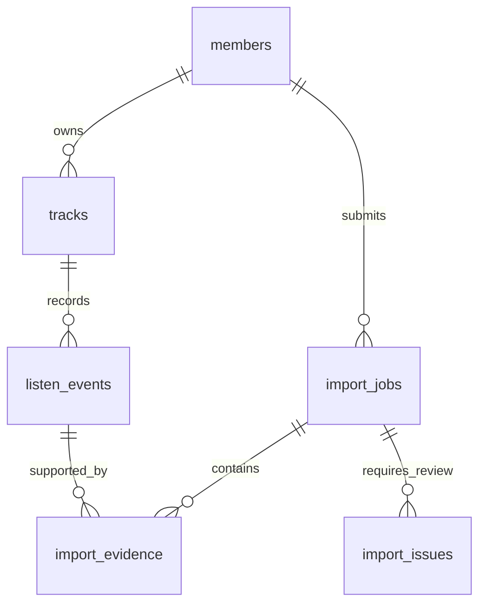

# Takeout 가져오기와 DB 저장

## 구현 범위

인증된 사용자가 ZIP/JSON 파일 업로드 → 필터·검증 → 500건 단위 DB statement → 원자적 commit → 처리 결과 반환. 동기식 개인 MVP API이며, 응답이 오기 전에 저장이 완료됩니다. 업로드 원본 임시 파일은 요청 종료 시 삭제합니다. LLM 호출은 없습니다.

비동기 worker/큐, 검토 항목의 자동 승인, 실제 음악 길이 추정, Android와 Takeout의 동일 재생 자동 병합은 포함하지 않습니다.

## 기존 개발 환경 재사용

`.env`와 `compose.yaml`을 그대로 사용합니다. 비밀번호를 소스에 복사하지 않습니다.

```powershell
docker compose up --build -d
```

`migrate` 서비스가 Alembic `0002`를 적용하고 API가 시작됩니다. DB 볼륨을 삭제하지 마세요. `0002`는 기존 Android 기록을 유지하면서 출처·미확인 시간을 구분합니다. 데이터가 있는 상태의 자동 downgrade는 가져오기 이력을 잃을 수 있어 명시적으로 차단했습니다.

Windows 줄바꿈 때문에 DB 초기화 스크립트가 실패하는 문제는 Dockerfile에서 LF로 정규화하도록 수정했습니다. 역할 생성은 이미 있는 역할의 비밀번호를 바꾸지 않고 없는 역할만 생성합니다. 기존 볼륨에서 초기 역할 생성이 실패했다면 DB 준비 후 아래를 한 번 실행할 수 있습니다.

```powershell
docker compose exec -T db sh /docker-entrypoint-initdb.d/01-roles.sh
```

## API

기존 회원가입·로그인 API에서 받은 Bearer 토큰을 재사용합니다. 사용자 ID는 요청으로 받지 않습니다.

| 메서드·경로 | 동작 |
| --- | --- |
| `POST /api/v1/imports` | multipart `file` 업로드 후 완료 결과 반환 |
| `GET /api/v1/imports/{job_id}` | 본인 작업 상태·결과 |
| `GET /api/v1/imports/{job_id}/issues?limit=20&offset=0` | 본인 검토·오류 항목 |

ZIP에 JSON이 여러 개이면 `POST /api/v1/imports?member=...`의 `member`에 정확한 내부 경로를 URL 인코딩해 전달합니다. JSON 파일 하나인 ZIP은 자동 선택합니다. HTML은 지원하지 않습니다.

Postman: Authorization → Bearer Token, Body → form-data → `file` 유형 File로 지정.

```powershell
curl.exe -X POST "http://127.0.0.1:8000/api/v1/imports" `
  -H "Authorization: Bearer YOUR_ACCESS_TOKEN" `
  -F "file=@C:/path/history.zip"
```

응답 예시(개별 오류·검토는 보존하고, 정상 항목은 저장):

```json
{
  "job_id": "00000000-0000-0000-0000-000000000001",
  "status": "completed",
  "parser_version": "1.0.0",
  "json_sha256": "원본 JSON 바이트의 SHA-256",
  "total": 151462,
  "accepted": 18793,
  "inserted": 18793,
  "duplicates": 0,
  "excluded": 132665,
  "review": 4,
  "errors": 0,
  "new_tracks": 5306,
  "distinct_tracks": 5306,
  "reasons": {}
}
```

항상 `accepted = inserted + duplicates`, `total = inserted + duplicates + excluded + review + errors`가 성립합니다. `distinct_tracks`는 이번 입력에서 확인한 서로 다른 영상 ID 수이지, 전체 DB 곡 수가 아닙니다. 이미 있는 곡이면 `new_tracks`에는 포함하지 않습니다.

완료 응답은 HTTP 200입니다. 개별 항목 오류가 있어도 `errors`로 집계하고, 파일 전체를 읽을 수 없으면 422, 크기 초과 413, 동시 가져오기·이벤트 충돌 409, 저장 완료를 확인할 수 없으면 503입니다. 다른 사용자의 작업은 존재하지 않는 ID와 똑같이 404입니다.

## 데이터 설계



| 테이블 | 역할 |
| --- | --- |
| `tracks` | 기존 회원별 곡. 출처 ID가 같으면 Android와 같은 곡 식별 규칙 사용 |
| `listen_events` | 기존 이벤트 + 출처·출처 이벤트 키·동일 키 출현 순번 |
| `import_jobs` | 파일 해시·파서 버전·작업 상태·집계 결과 |
| `import_evidence` | 이번 업로드의 원본 위치와 실제 저장 이벤트 연결. 채널·원본 제목·시각 보존 |
| `import_issues` | 검토·오류 이유와 원본 항목. 제외된 일반 검색 기록은 보관하지 않음 |

모든 신규 테이블은 `user_id`를 포함하고 PostgreSQL FORCE RLS를 적용합니다. 근거의 작업·이벤트 참조는 사용자 ID를 포함한 복합 외래키이므로 타 사용자의 자료에 연결할 수 없습니다. 앱 역할과 읽기 전용 역할을 재사용합니다.

### Takeout의 시간은 NULL

기존 이벤트에 `source='android_media_session'`이 기본 적용됩니다. Android는 기존처럼 30,000~86,400,000ms 범위만 저장합니다.

Takeout은 `source='google_takeout_my_activity'`, `listened_ms=NULL`이며 출처 이벤트 키가 필수입니다. DB CHECK로 출처·시간 조합을 강제합니다. 0초·30초로 바꾸지 않습니다. 채널명을 가수로 확정하지 않기 때문에 신규 곡의 `artist`는 NULL입니다.

기존 곡 목록·상세·통계에서도 가져온 기록을 조회할 수 있습니다. `total_listened_ms`는 측정 가능한 시간이 없으면 NULL이며, `measured_event_count`와 `unknown_duration_event_count`를 함께 반환합니다. Android와 Takeout이 섞이면 알려진 시간만 더합니다. 최초 기록 시각은 둘을 포함한 최솟값입니다.

### 중복과 같은 시각의 반복

`source_event_key`는 출처·영상 ID·UTC 시각의 해시이고, 파일 안의 동일 키 출현에 1부터 `occurrence_no`를 부여합니다. DB는 `(user_id, source, source_event_key, occurrence_no)`와 결정적 UUID로 재업로드를 멱등 처리합니다.

- 파일 A의 이벤트가 파일 B에 다시 있으면 새 이벤트를 만들지 않습니다.
- 같은 파일 안에 완전히 같은 키가 두 번 있으면 두 출현을 유지합니다. 다른 파일에서는 기존 출현 수만큼 중복 처리합니다.
- 모든 업로드의 근거 행은 별도로 남기므로 재업로드 근거가 늘어도 청취 이벤트 수는 늘지 않습니다.
- 영상 ID·시각이 같아도 실제 중복인지 식별할 원본 이벤트 ID가 없으므로, 동일 키의 다중 출현은 관찰된 출현 수를 보존하는 정책입니다. 실제 재생 횟수를 증명하지 않습니다.
- Android의 외부 ID가 같은 YouTube 영상 ID일 때만 같은 곡으로 연결됩니다. 다른 형식의 media_id는 별도 곡일 수 있으며 무리하게 합치지 않습니다.
- Android와 Takeout의 재생 이벤트는 시각 의미가 다르므로 자동 중복 제거하지 않습니다.

## 트랜잭션·실패 처리

파일 파싱은 DB 잠금 전에 수행합니다. 작업 `processing`을 먼저 저장한 뒤, 동일 사용자의 가져오기는 PostgreSQL 트랜잭션 advisory lock으로 한 번에 하나만 처리합니다. 다른 사용자의 가져오기는 동시에 진행할 수 있습니다.

500건 단위로 곡 upsert·이벤트 insert·근거 저장을 실행하지만 commit은 전체 데이터에 한 번만 합니다. 중간 배치 실패 시 해당 업로드의 곡·이벤트·근거·이슈는 모두 롤백하며, 작업 실패 상태는 별도 트랜잭션에 남깁니다. 커밋 확인 중 연결이 끊기면 성공 여부가 불명확할 수 있으므로 503 후 같은 파일을 재전송하거나 작업 조회로 확인합니다. 이미 완료된 작업을 실패로 덮어쓰지 않습니다.

프로세스 강제 종료 시 `processing` 행이 남을 수 있습니다. 이 버전에는 자동 재개 worker·lease가 없으며, 같은 파일을 새 요청으로 재전송합니다. 중단된 트랜잭션 잠금은 연결 종료 시 해제되고 미커밋 데이터는 롤백됩니다.

## 한도와 실행 방식

- 압축 업로드 상한 100 MiB, 압축 해제 JSON 상한 100 MiB, 항목 50만 건.
- 기본 사용자당 가져오기 3회/분, 배치 500건. `IMPORT_REQUESTS_PER_MINUTE`, `IMPORT_BATCH_SIZE`, `IMPORT_UPLOAD_MAX_BYTES`로 조절 가능.
- 파서는 현재 전체 JSON을 메모리에 로드합니다. 큰 입력의 동시 업로드는 메모리 부담이 있습니다. 공개 서비스 전에는 요청 본문을 받는 프록시의 크기·동시성 제한과 스트리밍 worker를 도입해야 합니다. 엔드포인트의 크기 검사는 multipart 파싱 후 실행되므로 네트워크 수신 단계의 메모리/디스크 제한을 대신하지 않습니다.
- 동기식 MVP이므로 게이트웨이 타임아웃을 고려해야 합니다. 네트워크 재시도는 같은 파일로 안전하게 할 수 있습니다.
- 실제 개인 원본·DB 덤프·비밀번호를 Git이나 포트폴리오에 포함하지 않습니다.

## 검증

권장: `.env`의 DB 연결을 읽고 기존 DB와 분리된 새 테스트 DB를 생성하는 스크립트를 사용합니다. 기존 DB에서 테스트용 회원을 만들지 않습니다.

```powershell
python scripts/test_postgres_isolated.py
```

이 스크립트는 기존 `.env`의 마이그레이션·앱·읽기 계정을 재사용하고, `firstlisten_import_test_...`라는 새 DB만 생성·마이그레이션·테스트합니다. 결과 확인을 위해 테스트 DB를 남깁니다. 비밀번호는 출력하지 않습니다. localhost가 IPv6로 연결을 지연시키는 환경에서는 테스트 연결에 127.0.0.1을 사용합니다. 기존 DB의 주요 테이블 건수가 바뀌지 않았는지도 확인합니다.

검증 시나리오: 신규 업로드, 동일/겹치는 파일 재업로드, 동일 시각 다중 출현, 지연 도착, NULL 시간, Android 기록과 통계, 중간 실패 롤백, 인증·타 사용자 작업 접근 차단, RLS 직접 조회·쓰기 차단, 동시 가져오기 잠금.
